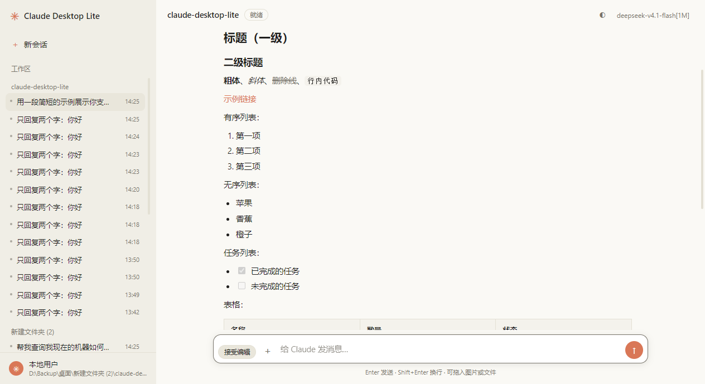
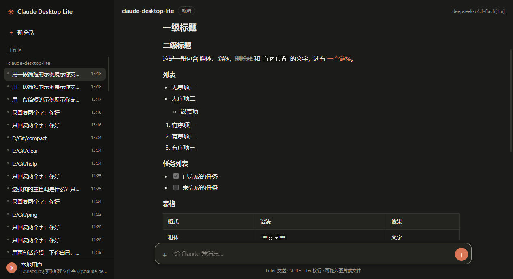

# Claude Desktop Lite

> 给 Claude Code CLI 套一个轻量、可定制的桌面图形界面——不重写 agent，只把 CLI 的能力可视化。

Claude Desktop Lite 是一个基于 **Electron** 的 Claude Code 桌面客户端。它直接复用官方 CLI 的
**双向 stream-json 协议**与 **`--permission-prompt-tool stdio` 权限协议**，因此行为与终端里的
Claude Code 保持一致：同一份会话、同一套权限、同一套斜杠命令和自定义命令。区别只是把终端里的
纯文本交互换成了图形化的流式对话、权限卡片、选项弹窗和侧栏会话管理。

界面参照 [dsh-claude-style](https://github.com/Nwflower/dsh-claude-style) 的 Claude 档设计，
亮/暗主题跟随系统。

<p align="center">
  
  
</p>

## 为什么用它

- **长回复更好读**：逐字流式输出，GitHub 风格 Markdown、表格、任务列表、代码高亮与一键复制。
- **权限不再靠盲打 y/n**：每次工具调用弹出权限卡片，可「允许 / 拒绝 / 始终允许」。
- **模型提问可以直接点选**：`AskUserQuestion` 渲染成单选、多选或自由输入弹窗，答案自动回传。
- **会话、项目、模型都在侧栏和顶栏**：直接读取 `~/.claude/projects/**/*.jsonl`，随时回看历史。
- **切换即时生效**：标准 / 接受编辑 / 计划 / YOLO 权限模式与模型均可在会话内切换。
- **关闭即清理**：Windows 下关闭窗口会结束整个 CLI 进程树，不留后台任务。

## 环境要求

- Windows 10 / 11（当前打包目标为 `win-x64`）
- Node.js 18+（仅从源码运行时需要）
- 已安装并登录 [Claude Code CLI](https://code.claude.com/docs/en/overview)，`claude` 在 `PATH` 中
- 如果使用第三方中转，沿用 `~/.claude/settings.json` 里的 `ANTHROPIC_BASE_URL` / 模型配置即可

## 快速开始

```bash
git clone https://github.com/wanwulizhi/claude-desktop-lite.git
cd claude-desktop-lite
npm install
npm start
```

也可以直接使用 `dist/Claude Desktop Lite Setup 0.4.2.exe`（未签名，SmartScreen 提示时选择
「更多信息 → 仍要运行」）。

## 已实现

## 已实现

- 聊天界面（**逐字流式输出**，Markdown 代码块，按消息 id 去重避免重复）
- **图形化权限审批**：`can_use_tool` 请求变成卡片，可选 允许 / 拒绝 / 始终允许
- **用户选择弹窗（AskUserQuestion）**：模型提问时显示选项卡片，支持单选、多选、自由输入；答案通过 `updatedInput.answers` 回写，YOLO 模式下同样有效
- 项目 + 会话侧栏：直接读 `~/.claude/projects/**/*.jsonl`，支持浏览与 `--resume`
- **附件**：📎 选择、拖拽、剪贴板粘贴图片；非图片文件拖入会转成 `@路径` 引用
- **斜杠命令补全**：扫描 `~/.claude/commands` 与 `<项目>/.claude/commands`；另带 4 个内置提示模板
- **模型切换**：右上角下拉选择（读取 `settings.json` 的模型别名），通过 CLI 的 `set_model` 控制消息**会话内即时生效**；也支持 `/model`、`/clear`、`/help` 客户端命令
- **完整 GFM Markdown**：标题、粗体/斜体/删除线、行内代码、链接、有序/无序/任务列表、表格、引用、代码块（语言标签 + 一键复制 + Prism 语法高亮）
- **权限模式选择**：输入框左侧切换 标准 / 接受编辑 / 计划 / YOLO，支持会话内热切换
- **主题切换**：右上角按钮选择 跟随系统 / 亮色 / 暗色，选择会记住
- **亮/暗双主题**：跟随系统，界面风格参照 dsh-claude-style 的 Claude 档
- 工具调用卡片（可展开查看参数与结果）
- 会话历史回放
- 停止按钮（Windows 上杀进程树）

## 健壮性

- **单实例运行**：重复启动会聚焦已有窗口，避免两个 CLI 同时写同一个会话
- **窗口状态记忆**：记住大小和位置；启动时按系统主题取背景色，减少闪烁
- **启动超时**：CLI 20 秒内未完成初始化会提示检查登录/网络，不会一直停在“启动中”
- **发送失败恢复**：进程未就绪或消息写入失败时，输入内容和附件会自动放回输入框
- **会话列表缓存**：按文件 `mtime + size` 缓存标题/cwd，不再每次刷新都重读所有 jsonl 头部
- **历史尾部读取**：大会话优先只读最后 2MB，内存中最多保留 300 条
- **流式渲染节流**：约 20fps 重绘 Markdown，长回复不再每帧全量解析
- **剪贴板图片**：没有磁盘路径的剪贴板/浏览器图片走 data URL，可直接粘贴发送
- **权限与路径校验**：session id、权限模式、图片扩展名均做白名单校验

### 国内网络

安装 Electron 或打包工具时如果下载失败，使用镜像：

```bash
ELECTRON_MIRROR="https://npmmirror.com/mirrors/electron/" npm install
```

CLI 会继承 `~/.claude/settings.json` 里的中转配置（`ANTHROPIC_BASE_URL` / 模型别名），
GUI 不需要额外设置。

## 已验证

| 项 | 结果 |
|---|---|
| CLI 双向 stream-json 启动 | ✅ 模型 `deepseek-v4.1-flash[1m]`，init/assistant/result 正常 |
| 用户消息写入格式 | ✅ |
| 权限请求 + 拒绝回写 | ✅ 触发 `PowerShell` 工具，拒绝后 CLI 正确收到并继续 |
| Electron 窗口 / preload / IPC | ✅ 端到端自动测试通过 |
| 逐字流式 + 完整消息去重 | ✅ 增量到达，DOM 中只有一条 assistant 气泡 |
| 斜杠命令展开 | ✅ `/ping` 触发 `.claude/commands/ping.md` 并返回预期内容 |
| 命令扫描 / 菜单渲染 | ✅ 识别 `project:ping`，菜单 1 项且可见 |
| 图片附件（base64） | ✅ 发送 `screenshot.png`，模型正确识别主色调为「深灰色」 |
| 真实按键回车发送 | ✅ 模拟键入 + Enter，消息发出并收到回复 |
| 模型列表 / 会话内切换 | ✅ 读到 5 个模型；`set_model` 返回 success，界面提示已切换 |
| 用户选择弹窗 | ✅ `AskUserQuestion` 卡片选择「面」后，CLI 收到 `updatedInput.answers` 并继续回复 |
| 权限模式热切换 | ✅ `set_permission_mode` 返回 success；进程复用不重启 |
| YOLO 模式 | ✅ 等旧进程退出后用 `--dangerously-skip-permissions` 重启，回复正常 |
| 主题切换 | ✅ `system → dark → system` IPC 生效 |
| Markdown 渲染 | ✅ 表格、任务列表、代码高亮、引用均正常 |
| 亮/暗主题 | ✅ 见 `shot-light.png` / `shot-dark.png` |

测试命令：

```bash
# 协议探针（不需要 Electron）
node scripts/probe.js "D:/path/to/project" "运行 node --version"

# 端到端（自动发一条问候后退出）
CDS_E2E=1 npx electron .

# 截图
CDS_SHOT="D:/tmp/shot.png" npx electron .
```

## 常见问题

### 终端里的 `claude --resume` 看不到 GUI 中的会话

这是 Claude Code CLI 的刻意行为，不是会话丢失。`/resume` 列表会过滤掉
`entrypoint` 为 `sdk-cli` / `sdk-ts` / `sdk-py` 的会话；GUI 通过
`--input-format stream-json`（SDK 模式）驱动 CLI，所以 GUI 会话都会被标记为
`sdk-cli`，不会出现在交互式 `/resume` 选择器里。另外 `/resume` 默认按 git 分支过滤，
其他分支上的会话需要按 `Ctrl+B` 切换为显示全部分支。

会话本身已经完整写入 `~/.claude/projects/<项目目录>/<session-id>.jsonl`，
可以直接按 ID 恢复：

```bash
claude --resume <session-id>
```

`<session-id>` 就是会话文件名去掉 `.jsonl`；GUI 侧栏中的会话也对应同一份文件。

## 打包

```bash
npm run pack   # 解包版：dist/win-unpacked/Claude Desktop Lite.exe
npm run dist   # NSIS 安装包：dist/Claude Desktop Lite Setup 0.4.2.exe
```

国内网络需要镜像：

```bash
ELECTRON_MIRROR="https://npmmirror.com/mirrors/electron/" \
ELECTRON_BUILDER_BINARIES_MIRROR="https://npmmirror.com/mirrors/electron-builder-binaries/" \
npm run dist
```

安装包未签名，Windows SmartScreen 会提示，点「更多信息 → 仍要运行」即可。
打包后的程序同样依赖 PATH 中的 `claude` 命令。

## 工作原理

```
Electron 主进程 (main.js)
  └─ spawn: claude --output-format stream-json --input-format stream-json
                    --verbose --permission-prompt-tool stdio [--resume <id>]
        ├─ stdout JSONL ──> 解析 system / assistant / user / result / control_request
        ├─ control_request(can_use_tool) ──> 权限卡片；AskUserQuestion ──> 选择弹窗
        └─ stdin <── {"type":"control_response", ... "behavior":"allow|deny",
                       "updatedInput": {..., "answers": {...}}}
```

渲染进程不发任何文件系统调用，全部经 `preload.js` 暴露的最小 API 走 IPC。

## 目录

```
main.js              主进程：会话扫描、CLI 生命周期、权限回写
preload.js           contextBridge 暴露的 API
renderer/            界面（原生 JS，无框架）
scripts/probe.js     无 GUI 协议探针
shot-light.png       亮色主题截图
shot-dark.png        暗色主题截图
```

## 性能（实测）

| 阶段 | 冷启动 | 预热后 |
|---|---|---|
| 进程 spawn | 24ms | 24ms |
| CLI 初始化（session init） | ~1.4s | 打开项目/会话时已完成 |
| 模型首 token | ~3.5s | ~1.3–3.8s（取决于中转） |
| 首条消息总计 | ~5.0s | ~1.3–3.9s |

措施：

- **进程预热**：选择项目或打开会话时立即 spawn CLI，把 ~1.4s 初始化移出发送路径
- **即时反馈**：发送后立刻显示“正在发送… / 等待模型响应… / 正在执行 Bash…”动画，避免界面看起来无响应
- 模型首 token 延迟由 `opencode.ai` 中转决定，客户端无法进一步降低

## 权限模式

| 模式 | 行为 |
|---|---|
| 标准 | 每次工具调用都弹出权限卡片 |
| 接受编辑 | 文件修改自动通过，命令仍需确认 |
| 计划 | 只读规划，不执行修改 |
| YOLO | 跳过所有权限确认（启动时加 `--dangerously-skip-permissions`） |

前三种通过 `set_permission_mode` 控制消息**热切换**，不重启进程；YOLO 需要重启，
所以回复进行中会提示等结束再切。

## 关于 CLI 内建命令

Claude Code 的 `/model`、`/clear`、`/help`、`/compact` 等内建命令由**交互式终端界面**处理，
在 stream-json / SDK 模式下不会生效（会被当成普通文本发给模型）。
因此这些命令由 GUI 自己实现：

| 命令 | 行为 |
|---|---|
| `/model` | 打开右上角模型下拉 |
| `/clear` | 开始新对话（保留项目目录） |
| `/help` | 列出可用命令 |

自定义命令（`.claude/commands/*.md`）不受影响，由 CLI 正常展开。

## 已知限制 / 下一步

1. **附件上限**：单条消息最多 6 张图、单张 20MB；历史回放不重新显示图片。
2. **MCP 管理**：读写 `~/.claude.json` / `.mcp.json`，通过 `--mcp-config` 传入。
3. **数学公式**：暂未接入 KaTeX。
4. **安全**：本应用不做任何自动放行；「始终允许」只回传 CLI 自己给出的
   `permission_suggestions`，由 CLI 持久化。
